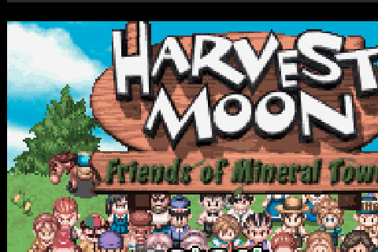
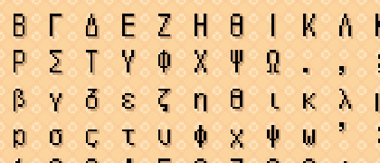
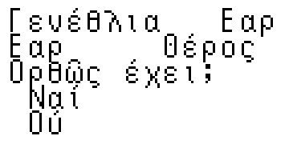

# Harvest Moon: Friends of Mineral Town (Game Boy Advance) — Ancient Greek Translation
### Ὥρα Θερισμοῦ: Οἱ Φίλοι τῆς Ὀρυκτοπόλεως (Ἑλληνικὴ Μετάφρασις)

A complete, unabridged translation of *Harvest Moon: Friends of Mineral Town* (Game Boy Advance) into **Ancient / Koine Greek**, featuring full polytonic orthography, custom modular Greek typography adapted from Handjet, ARM7/Thumb text-redirection assembly hooks, an interactive Greek Name Registration matrix, fully localized calendar/UI screens, and clean ROM patching tools.

| Dialogue & Cutscenes | Name Entry Matrix | Calendar & Seasons |
| :---: | :---: | :---: |
|  |  |  |

---

## 🎮 How to Play (Applying the Patch)

Apply the `.ips` patch to a clean copy of the original North American (USA) Game Boy Advance ROM. **No copyrighted game binaries are distributed in this repository** — only the IPS patch of modified bytes.

### Option 1: In the Browser (Easiest)
1. Open **[Marc Robledo's Online ROM Patcher](https://www.marcrobledo.com/RomPatcher.js/)**.
2. Under **ROM file**, choose your clean vanilla ROM: `Harvest Moon - Friends of Mineral Town (USA).gba`.
3. Under **Patch file**, choose [`patches/hm_fomt_greek.ips`](patches/hm_fomt_greek.ips).
4. Click **Apply patch** and save your patched `.gba` file.

### Option 2: Desktop Patching Tools
* **Windows:** Use **Lunar IPS** or **[Flips (Floating IPS)](https://www.romhacking.net/utilities/1040/)**.
* **macOS / Linux:** Use **MultiPatch** or `flips`.
* **Android:** Use **UniPatcher**.

### Base ROM Specifications
Ensure your clean vanilla ROM matches these checksums (standard No-Intro dump):

| Property | Value |
| :--- | :--- |
| **ROM File** | `Harvest Moon - Friends of Mineral Town (USA).gba` |
| **Original Size** | 8,388,608 bytes (8.0 MiB) |
| **Internal Code** | `A4NE` |
| **CRC-32** | `8E923168` |
| **MD5** | `80355c831a7a25b0f70dc021ebd344f1` |
| **SHA-1** | `a2fc3574f0a65a4fcf7682fb274b9d7eebdef963` |

### Patched Output Specifications
* **File Size:** 16,777,216 bytes (16.0 MiB expanded ROM).
* **CRC-32:** `91759DBA`
* **MD5:** `01d75ad91e68ba78603bcac2d2535d42`
* **SHA-1:** `d81c56a322bf067c4f7bca13c1ca6e24e2743f92`
* **Compatibility:** Tested and 100% compatible with mGBA, VBA-M, RetroArch, Delta, and real GBA hardware via EverDrive-GBA / EZ-Flash Omega.

---

## ✨ Features & Technical Enhancements

1. **Unabridged Dialogue Translation (9,400+ Messages):**
   - Every piece of dialogue, NPC interaction, festival text, cutscene monologue, item description, and system message translated into natural, idiomatic Ancient / Koine Greek.
   - Text wrapped strictly to $\le 28$ columns per line to respect hardware buffer boundaries and prevent character wrap clipping.

2. **Full Polytonic Greek Orthography:**
   - Full accentuation (ὀξεῖα, βαρεῖα, περισπωμένη).
   - Smooth (ψιλή) and rough (δασεῖα) breathings.
   - Clean classical capital diacritics placed preceding uppercase vowels (e.g., Ἆρα, Ἴασαι, Ἀγροῦ).
   - Authentic punctuation including ano teleia (`·`) and Greek erotematiko (`;`).

3. **Handjet-Inspired Modular Typography:**
   - Custom 8×12 font glyphs designed with crisp readability on original GBA screens.
   - Single-byte font dispatch table at `0x4FA7A0` rewritten for seamless rendering of Greek letters in UI dialogs, shops, menus, and speaker nameplates.
   - 2-byte UTF-16 code extension at `0xD0E3C` to dispatch custom polytonic vowels without memory collision.

4. **Interactive Greek Name Registration Matrix:**
   - Fully reworked on-screen keyboard at `0x0E89B6` for entering player, farm, dog, and animal names.
   - Supports 24 uppercase Greek letters, 25 lowercase letters (including medial `σ` and final `ς`), Greek vowels with acute accents, numerals, and punctuation.
   - Dynamic buffer encoding ensures custom names flow naturally into cutscenes and dialogues.

5. **Localized UI, Calendar, and Status Screens:**
   - Full localization of the Birthday Calendar screen at `0x0FBD18` (`Ὀρθῶς ἔχει;`, `Ναί`, `Οὔ`, `Γενέθλια`).
   - The four seasons: **Ἔαρ** (Spring), **Θέρος** (Summer), **Φθινόπωρον** (Fall), and **Χειμών** (Winter).
   - Localized days of the week (`Κυρ.`, `Δευ.`, `Τρί.`, `Τετ.`, `Πέμ.`, `Παρ.`, `Σάβ.`).
   - Cutscene speaker nameplates and NPC Master Table (`0x8104258`).

6. **Assembly Runtime Redirection Engine:**
   - ROM expanded to 16 MiB.
   - Runtime redirection stub at `0x087A0000` intercepts vanilla pointer queries and routes them to binary-searched Greek strings in expanded memory, preserving clean base-game logic while accommodating expanded Greek text.

---

## 🛠️ Building & Recompiling from Source

### Requirements
* Python 3.8+
* `Pillow` (`pip install Pillow`)

To build the 16 MiB patched ROM and regenerate the IPS patch:
```bash
python build_rom_patch.py
```

The script will automatically:
1. Locate your base vanilla ROM (`Harvest Moon - Friends of Mineral Town (USA).gba`).
2. Verify original checksums.
3. Ingest and pack translated dialogue from `data/greek_script.json` into expanded ROM memory.
4. Apply the runtime text redirection hook and polytonic font glyphs.
5. Apply single-byte UI strings, keyboard matrix, calendar screens, and speaker tables.
6. Generate `Harvest Moon - Friends of Mineral Town (Greek Pilot).gba` and `patches/hm_fomt_greek.ips`.

---

## 📁 Repository Structure

```
├── README.md               # Project overview and patching guide
├── LICENSE                 # Public domain license (The Unlicense)
├── .gitignore              # Excludes copyrighted ROMs and temporary artifacts
├── build_rom_patch.py      # Master standalone build script
├── patches/
│   └── hm_fomt_greek.ips   # Official translation patch file (IPS format)
├── data/
│   └── greek_script.json   # Translated polytonic Greek dialogue source (9,400+ entries)
├── gfx/
│   ├── Handjet.ttf         # Reference typography source font
│   ├── glyph.png           # Master 1bpp font tile sheet
│   └── screenshots/        # In-game capture showcase
├── tools/
│   ├── insert_text.py      # Main text injection & redirection engine
│   ├── apply_greek_ui_and_speakers.py  # UI, calendar, keyboard, and speaker patcher
│   ├── build_stub.py       # ARM7/Thumb assembly redirection stub generator
│   ├── glyphs.py           # Procedural glyph builder & diacritic composer
│   ├── hmgreek.py          # Encoding tables & ROM memory layout definitions
│   └── fix_line_wraps.py   # Line-wrap audit tool for GBA 28-column buffer
└── docs/
    └── HANDOVER.md         # Detailed technical notes and ROM memory map
```

---

## 📜 Credits & Acknowledgments
* **Translation & Localization:** Ancient Greek CI
* **Technical Engineering:** Antigravity (Google DeepMind)
* **Base Game:** *Harvest Moon: Friends of Mineral Town* © 2003 Marvelous Interactive Inc. / Victor Interactive Software, published by Natsume Inc.
